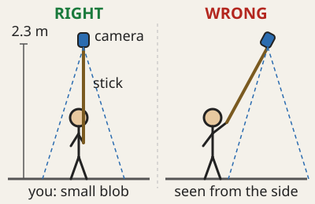
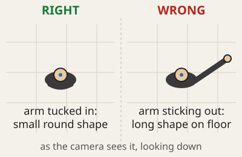
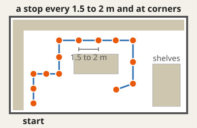
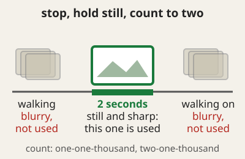
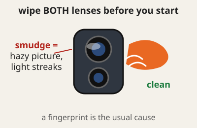

# How to record a walk

Five things decide whether a walk turns into a good tour. Each has a picture, a caption and a reason. The same guide is in the viewer: tap **?** and open **How to record a walk**.

You need a 360 camera on a stick (Insta360 X-series was used), about 10 minutes for a small room, and a clean cloth.

## 1. Stick straight up, camera directly over your head

**Hold the stick vertical, so the camera is straight above you, about 2.3 m up.**
*Why: the camera sees everything around it, including you. Straight above, you shrink to a small blob right under the lens, which the tour can paint out with the floor next to it. Leaning the stick forward puts the camera off to one side and you show up as a whole person on the floor, which is much harder to remove cleanly.*

## 2. Tuck your other arm in

**Keep your free arm against your body. Do not hold a phone, a bag or a tool out to the side.**
*Why: from above, a tucked arm is part of a small round shape. An arm sticking out makes a long shape across the floor, and what is in your hand hides even more of the room.*

## 3. A stop every 1.5 to 2 metres, and at every corner

**Walk a path through the space and stop every 1.5 to 2 m, and once at each corner or doorway. Come back along a different line if the room is wide.**
*Why: the tour connects each stop to the ones next to it. Stops closer than 1.5 m add nothing; stops further than about 4 m apart lose the link, and the floor you stood on can only be rebuilt from neighbours that saw it.*

## 4. Hold still for two seconds at every stop

**Stop, stand still with the stick steady, count "one-one-thousand, two-one-thousand", then walk on.**
*Why: the tour picks the sharpest frame around each pause. Walking frames are blurred by motion, and a blurred stop looks soft next to its neighbours.*

## 5. Wipe both lenses before you start

**Wipe both lenses with a soft cloth, and again if you touch one.**
*Why: a fingerprint on a lens is a haze over half of every picture, and no software fixes that afterwards.*

## If you do not follow this

Every stop goes through a privacy check after the person holding the stick is painted out (see the README). A stop that fails is **held back**: it is left out of the tour, and the build ends by telling you where the **review page** is (`frames/review/review.html` in the walk's folder; it is not inside the tour folder, because it shows the held pictures). Each held stop is listed with its picture, the straight-down view and the reason.

| What you did | What the review page says | Why |
|---|---|---|
| Stick leaning, camera off to the side | *a person-sized shape is still near the camera* or *something is more than 15 cm above the floor where you stood* | too much of you is in the picture to rebuild the floor under it cleanly |
| Arm or bag sticking out | *something ... stands more than 15 cm above the floor where you stood* | what sticks out is a separate shape that is taller than the floor |
| Someone else walked through the shot | *another person in the picture* | a person detector runs over the whole picture of every stop |
| A face is visible anywhere | *a face ...* | a face detector runs over the whole picture; faces are blurred in anything that is kept |
| Stops too far apart, or too few neighbours | *no floor to measure against* | the floor under you is only copied where two neighbouring stops agree on it; with no neighbours the check cannot verify the stop |
| Smudged lens | nothing | a hazy picture is not detected, so wipe the lenses |

You can still keep a held stop on purpose: look at it, then run `python privacy_gate.py --keep 010` and rebuild (faces stay blurred). The default is the safe one: **people are held back, not published**.
