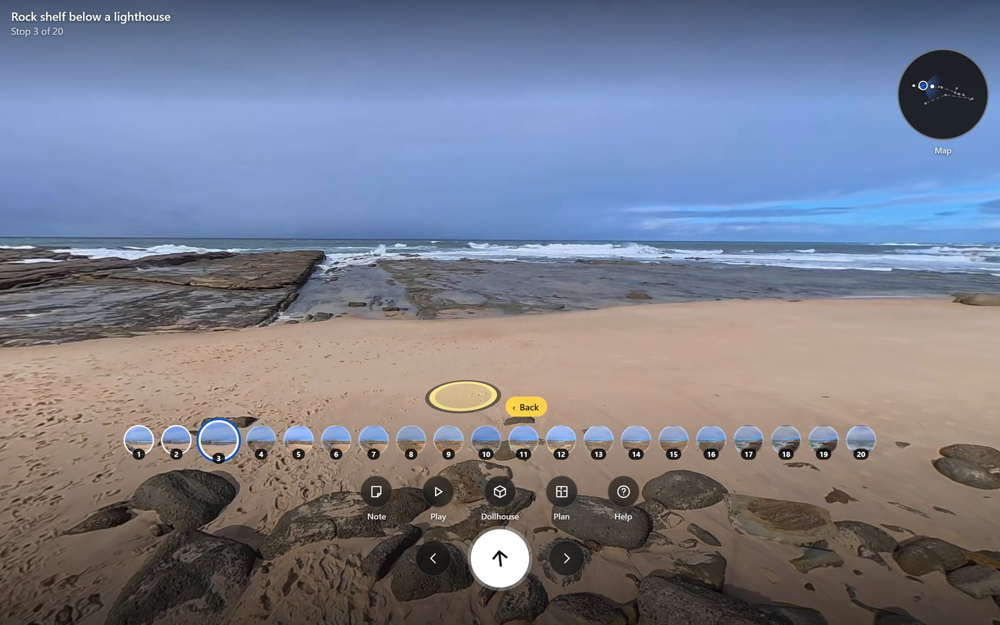
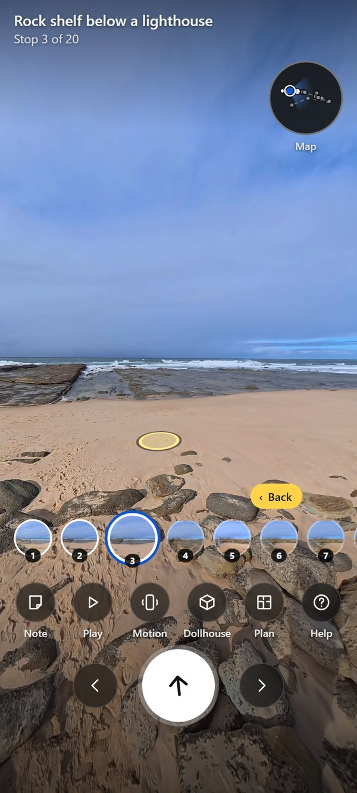

# shop-tour

Turn one walk with an Insta360 360 camera into a walkable 3D tour you open in any browser: tap the floor to glide there, a dollhouse, a floor plan.
Free, open source, and it runs on your own computer — nothing is uploaded anywhere.

<p align="center">
  
</p>
<p align="center">
  
  &nbsp;&nbsp;
  
</p>
<p align="center"><sub>Demo walk: <a href="https://commons.wikimedia.org/wiki/File:Norah_Head_Insta360_X5_Virtual_Tour_OHNE_TON.webm">Norah Head Insta360 X5 Virtual Tour</a> by GlennsYouTube, CC BY 3.0, built with this engine.</sub></p>

## Get started

1. **Download it**: the green **Code** button above, then **Download ZIP**, and unzip it (or `git clone https://github.com/K-rown/shop-tour`).
2. **Set it up, once**: double-click **`setup.bat`** (Windows) or run `bash setup.sh` (Linux). It installs everything and says what it is doing;
   the first time takes 10 to 30 minutes. Run it again any time — it skips what is done.
3. **Make a tour**: double-click **`start.bat`** (or `bash start.sh`). A page opens: type what the place is called, press **Choose your 360 video**,
   and pick the `.insv` file from your camera. About 10 minutes later press **Open your tour**.

Not recorded yet? [CAPTURE.md](CAPTURE.md) shows how in 10 minutes: camera on a stick straight above your head, stop for 2 seconds every couple of metres.

## Have an AI agent set it up for you

Paste this into Claude Code (or any coding agent that can run commands on your computer):

```text
Set up shop-tour for me and walk me through my first tour, end to end.
1. Clone https://github.com/K-rown/shop-tour and open the folder.
2. Run setup: setup.bat on Windows, bash setup.sh on Linux. Read its output. If something is missing,
   tell me in plain words what to install, help me install it, and run setup again until it says "All set".
3. If I have not recorded a walk yet, take me through CAPTURE.md one step at a time first.
4. Run start (start.bat, or bash start.sh). It opens a page with a "Choose your 360 video" button: tell me to
   type the place's name and pick my .insv file from the camera.
5. While it builds, tell me what step it is on. If it holds stops back for privacy review, show me each one and
   let me decide. Never decide for me, and never turn the privacy checks off.
6. When it says the tour is ready, open it with me. Do not upload my video or my tour anywhere unless I ask.
The details are in README.md, CAPTURE.md and docs/GUIDE.md.
```

## What you need

- A Windows or Linux PC. An NVIDIA graphics card makes a tour in about 10 minutes; without one it takes about 1.5 hours.
- An Insta360 `.insv` file (tested with an X5), or a stitched 360 `.mp4`.
- About 10 GB of free disk for the first setup, and an internet connection for it. After that it works offline.

## Privacy

Faces, licence plates and printed names are blurred into the pictures, and the person holding the camera is smudged out, before a tour is made.
Other people stay in the picture unless you choose otherwise; any stop held back for review waits for your answer. It is a safety net, not a guarantee:
look at every picture before you share a tour, and do not publish people who have not agreed. Details: [docs/GUIDE.md](docs/GUIDE.md#privacy-gate).

## More

Everything else — installing by hand, the one command (`python tour.py <video>`), every step, the switches, timings and troubleshooting — is in
[docs/GUIDE.md](docs/GUIDE.md). Contributing: [CONTRIBUTING.md](CONTRIBUTING.md).

## Licence and credits

Apache-2.0 (see `LICENSE`). Every dependency and model with its licence: [THIRD_PARTY_NOTICES.md](THIRD_PARTY_NOTICES.md).

Built by Kymani Brown for [Tradesman](https://tradesman.ai), which uses this engine to turn a worker's 360 walk into a tour. shop-tour stands on its own: it needs nothing from Tradesman, and nothing of Tradesman is in this repository.
